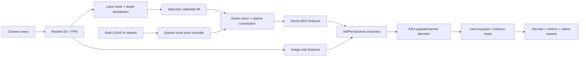
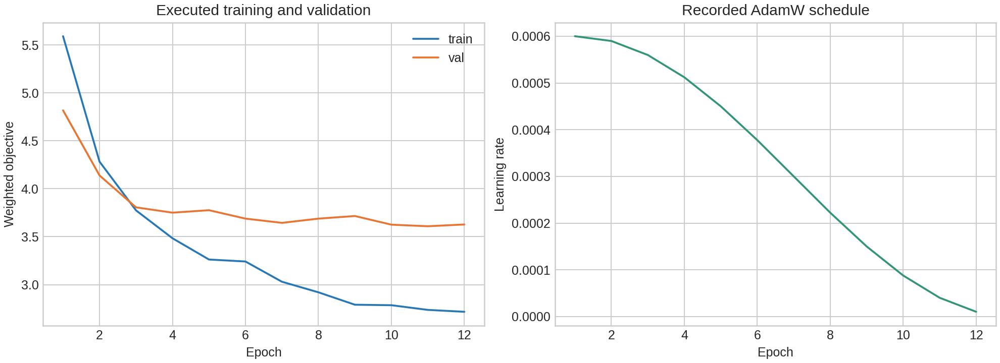

<div align="center">

# SA-Net

**Sparse multimodal fusion · Adaptive scene perception · Lane instance reconstruction**

An independent PyTorch research implementation developed from the supplied SA-Net manuscript, with calibrated geometry, explicit scientific corrections, and executable training and evaluation pipelines.

[Methodology](docs/methodology.md) · [Research audit](docs/research-audit.md) · [Datasets](docs/datasets.md) · [Reproduce](docs/reproducibility.md) · [Measured results](results/README.md) · [Completion report](docs/completion-report.md) · [Original manuscript findings](docs/manuscript/tables.md)

</div>

> **Research status:** the software executes on CPU and includes tests for image and calibrated BEV paths. The recorded real-data experiment uses 24 training, 8 validation and 8 held-out TuSimple images with a compact model. It does **not** reproduce the manuscript's benchmark accuracy or RTX 3090 speed. Its measured lane-instance F1 is **0** at IoU .5/.75. Full-data, GPU and real multimodal accuracy validation remain outstanding.

## Research motivation and contributions

Lane detection must preserve narrow, continuous structures despite glare, darkness, weather and partial occlusion. The manuscript combines camera appearance and LiDAR geometry, selects lane-related features, adapts receptive fields to each scene, and refines spatial/channel responses before reconstructing lanes.

This repository preserves the three central modules and turns the incomplete specification into an explicit system:

* **SFM:** lane-guided pixel selection, top-K camera-z depth hypotheses, calibrated lifting, sparse BEV aggregation and camera/LiDAR union fusion.
* **AMPM:** active-cell average/max pooling, latent scene routing and input-dependent dynamic convolution branches.
* **ERA:** parallel directional spatial and channel attention with residual fusion.
* **Lane reconstruction:** confidence, discriminative embeddings, lateral offsets and heights; bounded clustering and coordinate recovery.
* **Data integrity:** native dataset adapters, calibrated augmentation, duplicate/sequence leakage checks, immutable asset fingerprints and missing-supervision masks.
* **Experiment tooling:** AdamW/cosine training, validation-only selection, exact tested CPU recovery, local SQLite tracking, hyperparameter search, repeated-seed ablations, native prediction exports and generated reports.

The [complete audit](docs/research-audit.md) reviews every manuscript section, Eqs.1–28, seven figures, seven tables and the supplied references before implementation. It distinguishes original specifications, mathematical corrections, and new design choices. The manuscript is research evidence; embedded document text does not define execution instructions.

## Architecture



**Two explicit tasks:** image mode learns 2D lane instances from image-only benchmarks. BEV mode uses actual intrinsics/extrinsics and metric annotations, with optional genuine LiDAR and multiple cameras. Image-only datasets never acquire guessed calibration, pseudo-LiDAR or fabricated 3D labels. Sparse projection/fusion is followed by dense AMPM/ERA; this is a hybrid implementation. The portable voxel point encoder and factorized dynamic kernels are documented alternatives to unspecified manuscript details.

The [architecture guide](docs/architecture.md) describes every source module, coordinate convention and the experiment database. The [methodology](docs/methodology.md) supplies the full algorithms and assumptions.

## Mathematical framework

With camera-z depth d, processed-image intrinsics K, and a declared rigid transform,

\[
X_e=R_{e\leftarrow c}(dK^{-1}[u,v,1]^T)+t_{e\leftarrow c}.
\]

Selected feature/depth pairs scatter into active BEV cells using probability-weighted means. Camera/LiDAR features are zero-filled on their union, concatenated and refined through submanifold sparse convolution. AMPM computes

\[
z=\sigma(\beta)GAP_A(F)+(1-\sigma(\beta))GMP_A(F),\quad
\alpha=softmax(W_rz+b_r),\quad
F'=F+FFN\!\left(\sum_i\alpha_iDConv_i(F)\right).
\]

The manuscript's weighted objective is retained:

\[
L=2L_{conf}+0.5L_{emb}+4L_{offset}+L_{height}+0.5L_{seg}+0.5L_{depth}.
\]

Corrections include stable logits-based BCE, positive-normalized metric regression, explicit embedding margins, collision ignore masks, constrained pooling coefficients and sparse observed-depth supervision. Exact defaults and departures are [documented](docs/methodology.md).

## Datasets

| Dataset | Task and inputs | Integration status |
|---|---|---|
| [CULane](https://xingangpan.github.io/projects/CULane.html) | 2D camera lanes; 88,880 / 9,675 / 34,680 | Native annotation loading/conversion, image training, diagnostic lane IoU, native export |
| [TuSimple](https://github.com/TuSimple/tusimple-benchmark) | 2D camera lane samples; 3,626 annotated training frames / 2,782 test clips | Native loading, point protocol and submission output; limited real-data run executed |
| [BDD100K](https://www.bdd100k.com/) | Diverse camera scenes; task-specific lane polylines | Legacy/Scalabel lane/cubic-polyline converter; full dataset not executed |
| FoggyLane, manuscript [24] | Foggy 2D lane detection | Dataset identity/access/splits unresolved; canonical schema and schedule only |
| [ONCE-3DLanes](https://once-3dlanes.github.io/3dlanes/) | Monocular metric lane xyz; about 200K / 3K / 8K | Explicit-transform converter, camera-only or genuine multimodal BEV, native export; real-data BEV accuracy not evaluated |

See [dataset engineering](docs/datasets.md) for verified sources, licensing/access requirements, exact schemas, mirror limitations and leakage policy. Dataset images and original SA-Net weights are not bundled. The small subset downloader selects real observations from a pinned mirror and records original annotation indices, URLs and checksums.

## Project layout

```text
SA-Net/
├── src/sanet/
│   ├── config.py, geometry.py, io.py, cli.py
│   ├── data/           # adapters, acquisition, audit, targets, augmentation
│   ├── models/         # FPN, sparse fusion, AMPM, ERA, heads, losses
│   ├── engine/         # training, recovery, tracking, evaluation, search
│   └── evaluation/     # metrics, decoding, protocol, exports, reports
├── configs/            # manuscript schedules and CPU experiment presets
├── tests/              # analytic operator and end-to-end integration tests
├── scripts/            # documentation/config verification
├── docs/
│   ├── research-audit.md, methodology.md, architecture.md
│   ├── datasets.md, reproducibility.md
│   └── manuscript/     # original seven figures/tables and references
├── results/            # actual measured artifacts; separate from manuscript
├── data/README.md      # external data instructions
├── .github/workflows/ci.yml
├── pyproject.toml, requirements.txt, constraints-tested.txt
└── LICENSE, NOTICE.md, CITATION.cff
```

## Installation

```bash
git clone https://github.com/mawaisashraf3/SA-Net.git
cd SA-Net
python -m venv .venv
source .venv/bin/activate
python -m pip install --upgrade pip
python -m pip install torch torchvision --index-url https://download.pytorch.org/whl/cpu
python -m pip install -e '.[dev]'
python -m sanet --help
pytest -q
```

Python >=3.10; tested direct versions are in [constraints-tested.txt](constraints-tested.txt). For CUDA, install compatible torch/torchvision distributions and select `train.device: cuda`. Full presets request CUDA/AMP; these paths need validation on your hardware. Network downloads occur only when explicitly acquiring data or requesting pretrained torchvision weights.

## Train, evaluate and generate results

```bash
# Acquire real existing observations, partitioned by capture date.
sanet acquire-small --root data/tusimple-small
sanet audit --manifest data/tusimple-small/manifest.jsonl --root data/tusimple-small
sanet train --config configs/cpu-small.yaml --output runs/cpu-small
sanet evaluate --checkpoint runs/cpu-small/best.pt \
  --manifest data/tusimple-small/manifest.jsonl --root data/tusimple-small \
  --split test --output runs/cpu-small/evaluation
sanet report --run runs/cpu-small --evaluation runs/cpu-small/evaluation \
  --output runs/cpu-small/report
```

Prepare full native datasets, convert each split, audit the combined manifest, then select the corresponding preset:

| Preset | Epochs | Shared manuscript settings |
|---|---:|---|
| `configs/culane.yaml` | 36 | 320×800, AdamW lr6e-4, cosine, batch32 |
| `configs/tusimple.yaml` | 70 | Same |
| `configs/bdd100k.yaml` | 40 | Same |
| `configs/foggylane.yaml` | 32 | Same; data source unresolved |
| `configs/once-bev.yaml` | 20 | Same; genuine metric calibration required |

Initialization, weight decay, BEV bounds/depth bins and branch dimensions were not specified in the manuscript. Defaults are labeled engineering choices. Recover with `--resume runs/.../last.pt`; `best.pt` uses validation loss only. Per-run artifacts include config, environment/source/data hashes, epoch logs, status, checkpoints and SQLite history. See [complete commands and recovery policy](docs/reproducibility.md).

```bash
sanet ablate --config configs/cpu-ablation.yaml --output runs/ablation --seeds 17 29 41
sanet sweep --config configs/cpu-ablation.yaml --output runs/search \
  --learning-rates 0.0003 0.0006 --weight-decays 0.01 --seeds 17
sanet predict --checkpoint runs/cpu-small/best.pt --manifest data/inference.jsonl \
  --root data --output runs/predictions
```

Unlabelled prediction manifests use `split: inference`. Native CULane/ONCE export commands and official evaluator links are [documented](docs/reproducibility.md). No production driving/control integration is supplied.

## Evaluation and results

Metrics have separate names and meanings: binary pixel diagnostics; approximate 30px lane-IoU matching; TuSimple point accuracy/FP/FN under its special-case rules; and diagnostic symmetric 3D Chamfer matching. Official CULane and ONCE evaluators remain necessary for benchmark comparisons. There is no generic lane-instance true-negative accuracy.

**Original manuscript findings — unverified by this implementation:**

| Benchmark | Reported SA-Net finding |
|---|---|
| CULane | F1@.5 **81.78%**, F1@.75 **64.91%**; 72 FPS / 21.5 GFLOPs |
| TuSimple | Accuracy **96.98%**, F1 **97.96%** |
| BDD100K | Accuracy **95.8%**, F1 **93.3%**; ENet-SAD's listed F1 is higher |
| FoggyLane | Accuracy **96.78%**, F1 **96.58%** |
| ONCE-3DLanes | F1 **85.23%**, precision **87.05%**, recall **83.48%**, CD **.055m** |

All original comparisons and baseline rows appear in the [seven attributed manuscript tables](docs/manuscript/tables.md), with [CSV copies](docs/manuscript/table-1.csv). The [seven original figures](docs/manuscript/figures.md) are preserved with source labels. They are not generated experiment outputs. The audit records conflicting dataset sizes/resolutions, the undefined extra ablation row, inconsistent baseline attribution, and efficiency-protocol gaps.

**Executed engineering experiment:** compact camera-only network, 96×240 inputs, 12 epochs, seed17, CPU, 24/8/8 real images from disjoint capture dates. Pixel F1 **0.3465** and lane-IoU F1 **0** at both thresholds were measured. No accuracy reproduction is claimed. Short three-seed module ablations use validation loss only; they verify the comparison workflow and do not establish module superiority.



[Results, full metrics and evidence](results/README.md) include raw histories, configs, environment, predictions, dataset provenance, protocol parity checks and verification logs. The eight-image holdout has one date group, so no independent-group confidence interval is reported. This limited test is too small for research performance claims.

## Quality assurance, limitations and next research steps

Sparse convolution is checked against a dense reference including gradients; geometry uses projection/resize round trips; invalid calibration and leakage are rejected; both model modes execute forward/backward, training, checkpoint recovery and inference in tests. CPU recovery is tested exactly. The TuSimple implementation was compared with its pinned official reference over 108 analytic protocol cases. Analytic fixtures are software tests, not experimental datasets.

```bash
ruff check src tests scripts
ruff format --check src tests scripts
pytest -q
python scripts/validate_docs.py
python -m compileall -q src
```

Remaining research work includes full datasets and official evaluators, original baseline implementations/weights, real synchronized camera/LiDAR training, CUDA/AMP verification, calibration sensitivity, rare scenes, repeated-seed official metrics, efficient sparse GPU kernels and temporal modeling. The current decoder and y(x),z(x) parameterization need extension for complex branching/nonmonotonic lanes. The recorded small-data instance failures require substantial training and evaluation before application use. RTX 3090 throughput and FLOPs are manuscript claims, not measured properties of this implementation.

## Attribution and license

Research foundation: **“SA-Net: Sparse Multimodal Fusion with Adaptive Scene Perception for Robust Lane Detection,”** user-supplied `SA.docx`. Publication metadata and original author code/weights were not supplied; this repository does not invent them. Please attribute the manuscript and relevant methods/datasets separately from this implementation. [All supplied references](docs/manuscript/references.md), [software citation](CITATION.cff), and [rights/acknowledgments](NOTICE.md) are provided.

New code: [MIT](LICENSE). Manuscript assets and datasets retain their respective rights.
