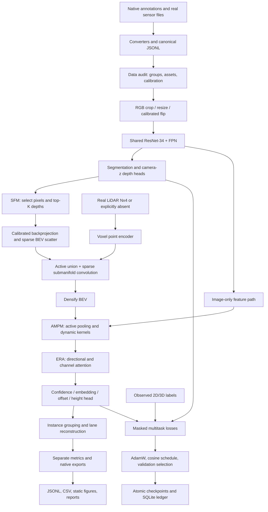
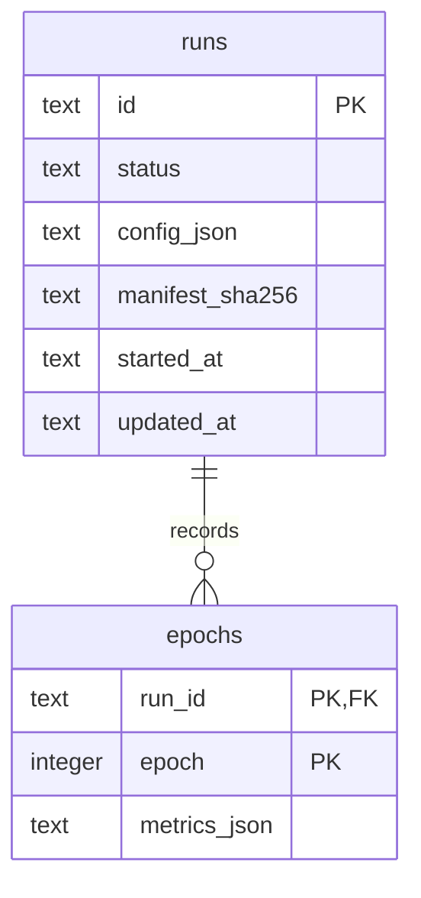

# Architecture, modules and storage

The model receives RGB, intrinsics, extrinsics and optional point clouds. It does not read labels inside `forward`. Data preparation produces a separate target dictionary. Image-only mode avoids assigning metric geometry to datasets that do not supply calibration. BEV supports multiple cameras and independently missing LiDAR. Sparse operations cover selection, voxel encoding, cell aggregation and union convolution; AMPM/ERA/head are dense. Dense cost scales with BEV dimensions even when few cells are occupied.

## File responsibilities

| File / directory | Responsibility |
|---|---|
| `src/sanet/config.py` | Typed configs, strict unknown-key and range checks, YAML loading, manuscript schedule defaults |
| `src/sanet/geometry.py` | Rigid calibration validation, optical camera projection/backprojection, center-aligned resize/crop matrices |
| `src/sanet/io.py` | Strict JSONL, path confinement, streaming SHA-256, atomic text/JSON writes |
| `src/sanet/data/adapters.py` | TuSimple, CULane, legacy/Scalabel BDD100K and explicit-transform ONCE conversion |
| `src/sanet/data/acquire.py` | Pinned real subset download, mirror availability intersection, checksums and provenance |
| `src/sanet/data/audit.py` | IDs, split/sequence leakage, duplicate bytes, image/point structures, calibration and dataset fingerprints |
| `src/sanet/data/dataset.py` | Multi-view sensor loading, augmentation, normalization, sparse observed depth targets, batching/device transfer |
| `src/sanet/data/targets.py` | Discrete 2D instance rasterization and BEV keypoint/offset/height targets; ignore collisions |
| `src/sanet/models/backbone.py` | ResNet-34/FPN and named compact alternative |
| `src/sanet/models/sparse.py` | Active-cell representation, weighted aggregation, union zero filling and sparse neighborhood convolution |
| `src/sanet/models/fusion.py` | Lane/depth selection, calibrated lifting, voxel point encoder and fused sparse refinement |
| `src/sanet/models/attention.py` | Active GAP/GMP blend, latent routing, dynamic kernel mixtures, residual FFN and ERA |
| `src/sanet/models/network.py` | Integrated modes and four-map prediction head |
| `src/sanet/models/losses.py` | Balanced confidence/segmentation BCE, discriminative embeddings, masked positive regression and sparse depth CE |
| `src/sanet/engine/train.py` | Training/validation passes, optimizer and scheduler, gradient clipping, finite checks, validation-only checkpoint selection |
| `src/sanet/engine/checkpoint.py` | Atomic model/optimizer/scheduler/scaler/RNG state, safe weights-only restore, explicit asset identity checks |
| `src/sanet/engine/tracking.py` | Seed policy, source/environment provenance and SQLite experiment ledger |
| `src/sanet/engine/evaluate.py` | Batch-one inference, synchronized timing, metric separation, JSONL and TuSimple submission output |
| `src/sanet/engine/sweep.py` | Validation-only grid search; real module toggles and repeated-seed ablations |
| `src/sanet/evaluation/decode.py` | Bounded embedding clustering, row keypoints, metric reconstruction and original-image conversion |
| `src/sanet/evaluation/metrics.py` | Cardinality-first matching, raster IoU, pixel diagnostics, resampled Chamfer and group bootstrap |
| `src/sanet/evaluation/tusimple.py` | Official point-protocol semantics and row sampling |
| `src/sanet/evaluation/export.py` | Native CULane text files and ONCE optical-coordinate JSON export |
| `src/sanet/evaluation/report.py` | Learning curves, epoch CSV, holdout charts, geometry figures and Markdown reports from executed logs |
| `src/sanet/cli.py`, `__main__.py` | Installed `sanet` command and `python -m sanet` entry point |
| `configs/` | Five manuscript schedule presets; compact CPU experiment and ablation presets |
| `tests/` | Analytic operator fixtures, model/gradient tests, adapters/leakage/calibration checks, metric and training/inference/recovery integration |
| `docs/manuscript/` | All seven original tables, CSV copies, seven attributed figures, source checksum and 43 supplied references |
| `results/` | Actual measured logs, config, provenance, metrics, reports and generated figures |
| `.github/workflows/ci.yml` | CPU lint, format, test, import and package checks; external datasets not required |

## SQLite experiment ledger

`runs/experiments.sqlite` contains two tables:

The composite primary key `(run_id, epoch)` indexes histories; the run ID indexes status/config. Parameterized SQL and foreign keys maintain integrity. The ledger tracks `running`, `completed`, `interrupted_for_resume`, and `failed`. It does not store RGB, LiDAR or model weights. JSONL/NPY are appropriate for large immutable data; object-store/dataset streaming and distributed ledgers would be separate scale extensions. SQLite is not required for prediction alone.

## Reproducibility and failure boundaries

Training audits all manifest assets before starting. Model selection uses minimum validation total objective; test samples are not loaded during training or hyperparameter selection. Checkpoints restore optimizer, cosine phase, AMP scaler, Python/Torch/CUDA RNG and shuffled DataLoader generator. Configuration, manifest and asset bytes must match to resume. Augmentation uses Torch RNG; workers seed Python and NumPy. CPU recovery is tested bit-for-bit. CUDA determinism is requested with warning mode, and may depend on backend/version; CUDA/AMP are configurable but were not exercised here.

Atomic JSON/checkpoint replacement protects completed artifacts. A failed run is recorded in SQLite and exceptions propagate with context. Mid-epoch recovery starts from the last completed epoch. There is no distributed trainer, asynchronous service, safety-certified control integration or trained production model in this release. Those require additional engineering and full-data validation.
