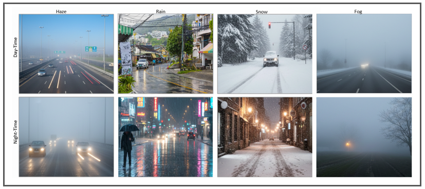
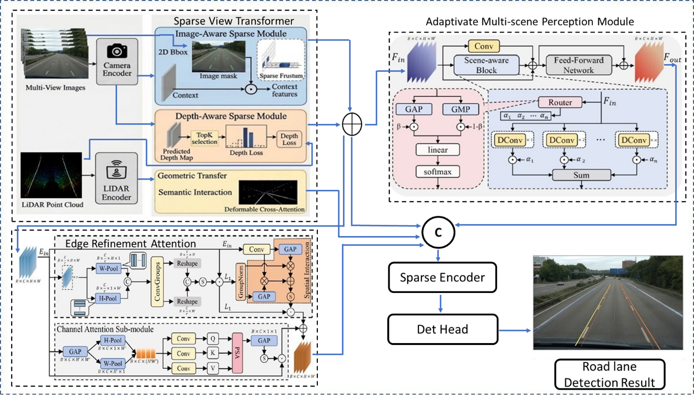
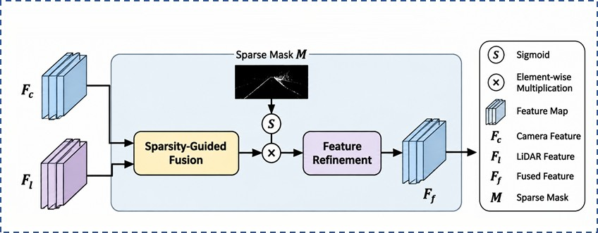
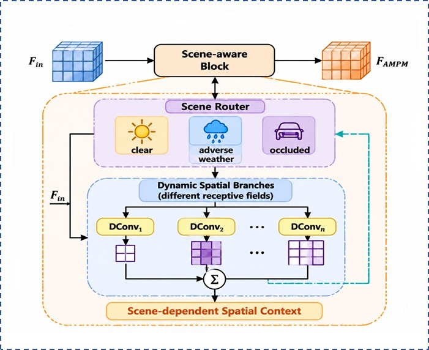
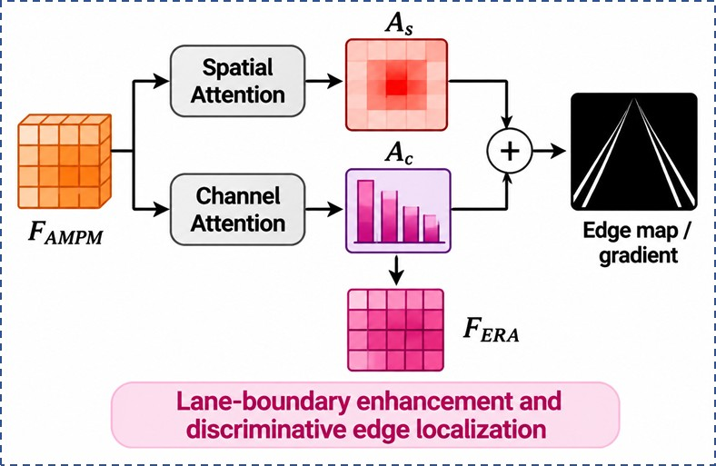
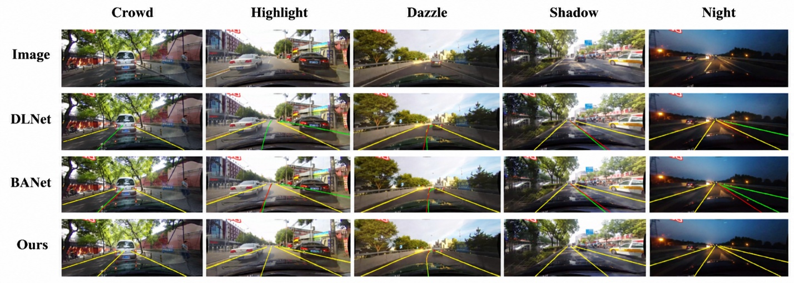
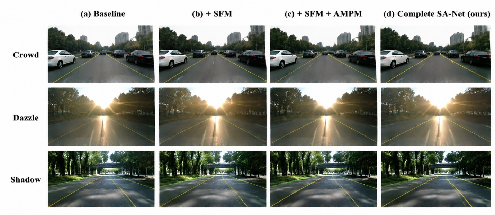

# Original manuscript figures

Extracted unchanged from SA.docx at the user’s request. These are manuscript illustrations and reported qualitative results, not outputs of this implementation. Rights remain with the manuscript authors and any underlying dataset/image owners.

## Figure 1

Challenging weather and illumination examples.

## Figure 2

Overall architecture; differs from the lane-specific equations in several blocks.

## Figure 3

SFM conceptual mask modulation; calibrated lifting is described in text.

## Figure 4

AMPM scene routing and dynamic branches.

## Figure 5

ERA conceptual spatial/channel branches; no explicit edge supervision is specified.

## Figure 6

Reported qualitative model comparison on CULane; not independently regenerated.

## Figure 7

Reported qualitative ablation on CULane; four columns versus five table configurations.