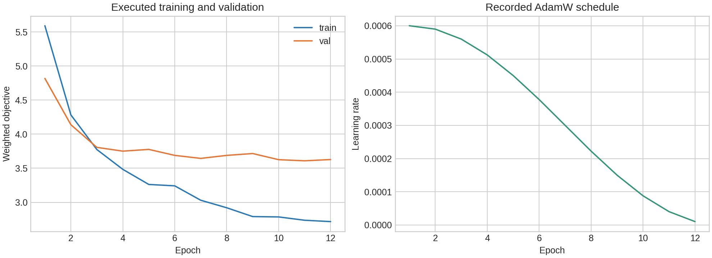
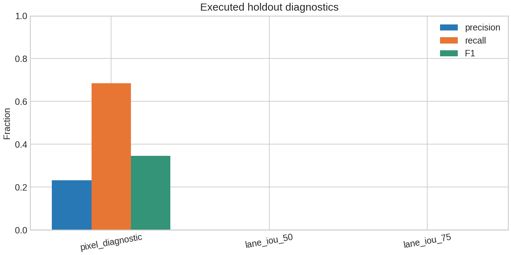
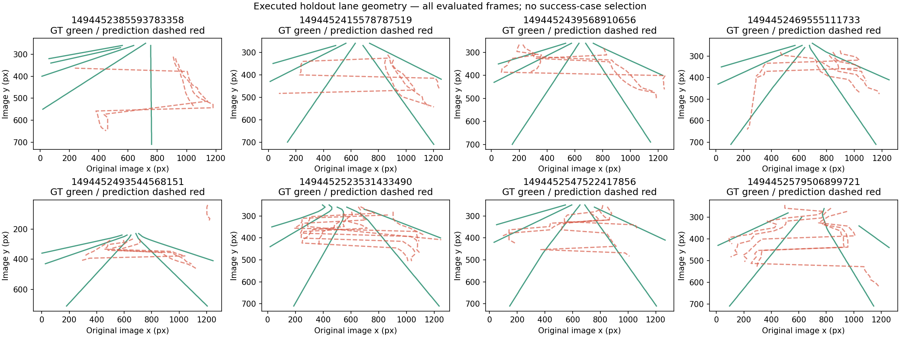

# Executed results and verification evidence

This repository records **limited engineering experiments**, not reproduction of the supplied manuscript. All data observations are real TuSimple images and existing labels. Analytic test fixtures are identified as software tests and excluded from scientific performance claims. [Original manuscript findings](../docs/manuscript/tables.md) are separate.

## Main real-data experiment

Compact camera-only model, 96×240 inputs, 24 training / 8 validation / 8 holdout images, 12 epochs, seed17, AdamW lr6e-4 and cosine schedule, CPU. Dates 0313/0531/0601 are disjoint across partitions, drawn from native training labels and a partially populated pinned public mirror. The local test set is not the official TuSimple test set. Initialization is from scratch.

Validation selected epoch **11** (zero-based index 10) with minimum weighted objective **3.609037**. Test labels were not used for selection. The initial holdout was inspected during development; the committed replay confirms reproducibility on the same holdout and is not a new independent performance estimate.

| Measured diagnostic | Value |
|---|---:|
| Pixel precision | 0.231935 |
| Pixel recall | 0.684372 |
| Pixel F1 | 0.346456 |
| Pixel IoU | 0.209523 |
| Lane-IoU F1 @ .5 | 0.000000 |
| Lane-IoU F1 @ .75 | 0.000000 |
| TuSimple protocol point accuracy | 0.597098 |
| TuSimple protocol FP rate | 0.982143 |
| TuSimple protocol FN rate | 0.968750 |
| Mean model forward latency | 10.114 ms |
| Mean model + decode/transfer latency, excluding file I/O/preprocessing | 17.033 ms |

The lane match counts are TP=0, FP=37, FN=39. **Instance detection failed under this small experiment.** Pixel segmentation improvement does not establish successful lane reconstruction. Reported manuscript F1/FPS/GFLOPs are not reproduced. Timing uses batch1 at this smaller resolution, includes the first forward and is not comparable to RTX3090/full-resolution speed. The holdout has one date group, so a group-bootstrap confidence interval is intentionally unavailable.

* [Full metrics](cpu-small/metrics.json), [raw predictions](cpu-small/predictions.jsonl), [native TuSimple submission](cpu-small/tusimple-submission.jsonl)
* [Configuration](cpu-small/config.json), [environment/source hash](cpu-small/environment.json), [audit and data fingerprint](cpu-small/data-audit.json), [acquisition provenance](cpu-small/data-provenance.json)
* [Raw epochs](cpu-small/history.jsonl), [CSV](cpu-small/epochs.csv), [training log](cpu-small/training.log), [report](cpu-small/report.md)

Green lines are true lane coordinates; dashed red lines are actual decoded predictions. Every evaluated frame is included. The figure exposes the poor instance association and continuity of this limited training run.

## Ablations and hyperparameter workflow

Nine 4-epoch image-mode runs evaluate three variants over seeds17/29/41, using training/validation only:

| Variant | Mean best validation objective | Sample SD |
|---|---:|---:|
| backbone_head | 4.072444 | 0.230428 |
| plus_ampm | 3.775999 | 0.301559 |
| plus_ampm_era | 4.118690 | 0.226849 |

These are short optimization diagnostics, not F1 or causal evidence that a module improves accuracy. The baseline is the independent compact backbone/head, not DLNet. SFM requires calibrated BEV data and is not included in image ablations. [Raw trial results](ablation/ablation.json), [per-run histories/configs](ablation/), [summary](ablation/report.md), and [plot](ablation/validation-ablation.png) are included.

A two-trial learning-rate search (3e-4/6e-4, weight decay .01, seed17, 4 epochs) selected 6e-4 by validation objective. [Search evidence](search/search.json) includes both measured trials. No test metrics were used for that selection, and this small search does not establish a generally optimal learning rate.

## Executed quality checks

* **42 unit/integration tests passed:** [output](verification/pytest.txt), [JUnit](verification/junit.xml). Geometry, invalid calibration, sparse-vs-dense values/gradients, voxel boundaries, absent modalities/empty support, image and BEV training/evaluation, native adapters/exports, duplicate/sequence leakage, unlabelled inference, SQLite and exact checkpoint recovery.
* **TuSimple official-reference parity:** [108 analytic cases](verification/tusimple-protocol-parity.json), maximum absolute difference 1.11e-16. This verifies protocol semantics, not benchmark accuracy.
* **Experiment replay:** [exact equality of selected model tensors](verification/experiment-replay.json) for the same real-data schedule/seed. Run environments record the source commit and Python-source fingerprint.
* **Unlabelled real-image prediction:** [measured execution](verification/unlabelled-inference.json), followed by [native text export](verification/native-export.txt).
* **Lint and format:** [recorded output](verification/lint.txt). **Wheel build/install:** [build](verification/package-build.txt), [isolated import](verification/wheel-install.txt).
* **Manuscript arithmetic:** [25 reported P/R/F1 rows checked](verification/manuscript-arithmetic.json); flags require clarification because macro averages can differ from harmonic means. No reported observation was replaced with a calculation.

See [reproducibility instructions](../docs/reproducibility.md) for replay commands. No real multimodal benchmark, full official benchmark evaluation, CUDA/AMP run, model safety validation, or production accuracy claim is made. Real calibration/data access, full schedules, untouched sequences and official baseline comparisons remain necessary.
