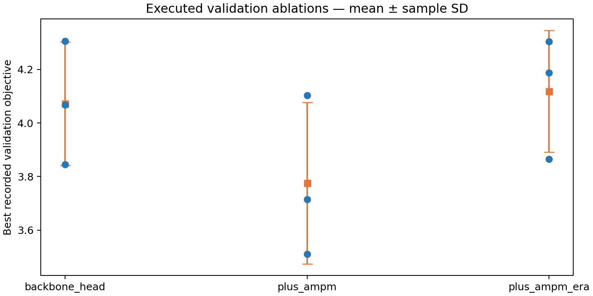

# Executed short image-mode ablations

Per-run budgets, datasets and seeds are recorded in the accompanying configs, audits and histories; no test scoring.

These runs verify the ablation workflow. Random initialization, short schedules and limited data prevent a causal or benchmark superiority claim. The baseline is this implementation's compact backbone/head, not DLNet. Loss combines terms and is not lane F1.

| Variant | Seeds | Mean best validation objective | Sample SD |
|---|---|---:|---:|
| backbone_head | [17, 29, 41] | 4.072444 | 0.23042848292773224 |
| plus_ampm | [17, 29, 41] | 3.775999 | 0.301559121421089 |
| plus_ampm_era | [17, 29, 41] | 4.118690 | 0.22684903065267117 |

