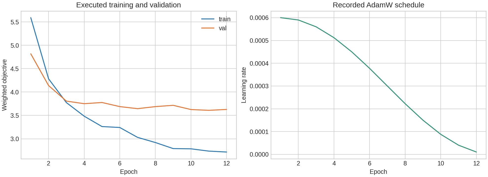

# Executed experiment report

Actual run logs; no manuscript benchmark reproduction is claimed.

Epochs: 12. Minimum validation objective: 3.609037.

Evaluated 8 test samples on cpu.

| Protocol | Precision | Recall | F1 |
|---|---:|---:|---:|
| pixel_diagnostic | 0.231935 | 0.684372 | 0.346456 |
| lane_iou_50 | 0.000000 | 0.000000 | 0.000000 |
| lane_iou_75 | 0.000000 | 0.000000 | 0.000000 |

Protocols are not directly comparable.
